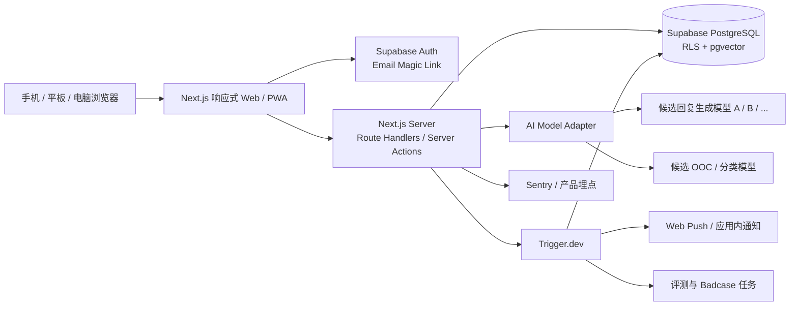
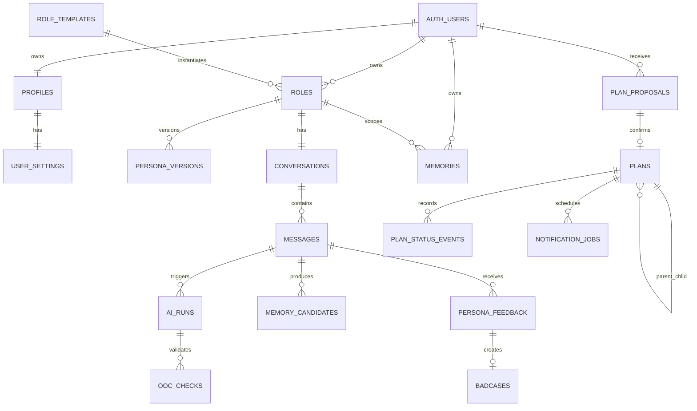

# 言行 V0 技术方案与数据结构

## 0. 文档信息

| 项目         | 内容                                             |
| ------------ | ------------------------------------------------ |
| 产品版本     | V0（MVP）                                        |
| 技术文档版本 | V0.3                                             |
| 日期         | 2026-08-28                                       |
| 当前状态     | 主体方案已确认；生成与校验大模型供应商待横评定型 |
| 对应 PRD     | `prd文档.md` V0.7                                |
| 产品形态     | 移动端优先的响应式 Web＋可安装 PWA               |

本文档把已经确认的产品规则转换为可实现、可演进的数据和系统设计。除生成与校验大模型需要通过多模型横评后定型外，其余技术基线已于 2026-08-28 确认。模型供应商与模型名称不作为业务层依赖；后续定型或更换模型、向量维度、数据保留策略时，需要新增决策记录并执行回归评测或迁移评估。

---

## 1. 已确认的技术边界

1. V0 只开发一套响应式 Web 应用，并提供 PWA 安装能力；不同时开发独立原生 App 和另一套桌面 Web。
2. 同一套业务、接口和数据服务手机、平板与电脑端；响应式差异只存在于界面布局与少量交互呈现。
3. 账号只使用邮箱 Magic Link 免密码登录，不建设手机号、密码找回、第三方登录。
4. 每位用户首次进入时幂等创建 3 个默认角色；每个角色只有一条独立持续对话时间线。
5. 基础用户记忆与所有计划属于用户级数据；角色人设、聊天、关系和角色专属记忆属于角色级数据。
6. 正式计划必须在用户确认后创建；模型识别出的内容先保存为待确认提案。
7. AI 回复必须通过发送前 OOC 校验；不合格时最多自动重写一次，仍失败则不发送草稿。
8. V0 只处理文字输入输出；没有图片、语音和视频上传，因此暂不需要用户媒体存储系统。
9. 浏览器通知只用于有提醒时间的日计划；周、月和年度目标不直接调度系统通知。
10. 所有用户表必须启用行级权限控制，任何查询都同时校验用户 ID 和资源作用域。

---

## 2. 技术基线与待定项

### 2.1 技术选型

| 层级       | 方案与状态                                                        | 用途与原因                                                                                                           |
| ---------- | ----------------------------------------------------------------- | -------------------------------------------------------------------------------------------------------------------- |
| Web 框架   | Next.js App Router＋TypeScript                                    | 一套代码覆盖响应式页面、服务端渲染、接口与部署；适合 V0 快速迭代                                                     |
| UI         | Tailwind CSS＋CSS Variables＋Radix/shadcn 类无障碍基础组件        | Figma 颜色、间距、圆角可落成 Token；Modal、菜单、表单可复用并保留键盘可访问性                                        |
| 表单与校验 | React Hook Form＋Zod                                              | 登录、人设、计划与设置表单统一校验；Zod Schema 同时约束接口，并转换为供应商中立的 JSON Schema 作为 AI 结构化输出合同 |
| 客户端数据 | Server Components 为主；TanStack Query 仅用于聊天、计划和乐观更新 | 避免一开始建立复杂全局状态；实时交互区域再使用客户端缓存                                                             |
| 认证       | Supabase Auth Email Magic Link                                    | 直接支持邮箱免密码会话和回调，减少账号系统开发量                                                                     |
| 主数据库   | Supabase PostgreSQL                                               | 关系约束、事务、RLS、JSONB 和可审计历史都适合本产品                                                                  |
| 向量检索   | PostgreSQL＋pgvector                                              | 记忆和摘要与业务数据处于同一权限边界，V0 不引入独立向量数据库                                                        |
| AI 接入    | 服务端 Model Adapter＋多模型评测框架；生成与校验模型待定          | 同一业务输入可以运行多组 `provider＋model` 候选；业务层不直接依赖任何供应商 SDK、API 形态或模型名称                  |
| 后台任务   | Trigger.dev                                                       | 记忆抽取、提醒调度、情绪回访、评测与重试不阻塞聊天请求                                                               |
| Web Push   | 标准 Web Push＋VAPID；后台任务触发                                | 兼容 PWA；权限不支持或未授权时退化为应用内提醒                                                                       |
| 部署       | Vercel＋Supabase＋Trigger.dev Cloud                               | 运维量低，适合 V0；所有密钥只存在服务端环境                                                                          |
| 错误监控   | Sentry                                                            | 页面、接口和后台任务异常统一追踪，并关联匿名 trace ID                                                                |
| 产品埋点   | PostHog                                                           | 记录 PRD 第 10 章事件；禁止发送聊天正文、敏感记忆或认证凭证                                                          |
| 测试       | Vitest＋Testing Library＋Playwright                               | 单元、组件、接口与手机/桌面端核心流程回归                                                                            |

### 2.2 V0 不建议引入

- 独立微服务、Kubernetes、Kafka 或自建消息队列；
- 独立向量数据库；
- GraphQL；
- Redis 作为必选依赖；
- 多仓库或复杂 Monorepo；
- 自建账号密码系统；
- 为桌面端复制一套业务组件和接口。

当真实负载证明 PostgreSQL、Trigger.dev 或单体应用成为瓶颈后，再拆分对应模块。

### 2.3 生成与校验大模型横评原则

- 生成模型和 OOC/结构化校验模型分别评测，不预设必须使用同一家供应商或同一个模型；
- 至少比较两组候选 `provider＋model` 组合，候选可以来自同一供应商的不同模型，也可以来自不同供应商；
- 所有候选使用同一套冻结评测集、同一人设快照、同一上下文和同一输出合同，禁止为某个候选单独优化 Prompt 后直接比较；
- 核心质量指标包括中文自然度、人设一致性、OOC 七维评分、长期记忆真实性、计划识别准确率、结构化输出成功率和安全边界；
- 工程指标包括 P50/P95 延迟、超时与错误率、单次成功对话成本、上下文窗口、限流、服务可用区域及数据保留政策；
- 第一轮使用合成数据和经过脱敏授权的回归样本离线盲测；在隐私条款和数据处理范围明确前，不把真实用户聊天同时发送给多个供应商；
- 横评完成后分别确认主生成模型、主校验模型及可选降级模型，并把选择结果写入新的策略版本，不回写业务代码。

---

## 3. 总体架构



### 3.1 架构原则

- **模块化单体优先。** V0 在一个 Next.js 工程中按业务域分模块，但数据库、接口和后台任务边界清晰，未来可以单独拆出 AI Runtime 或通知服务。
- **客户端不持有高权限密钥。** 模型 Key、Supabase Service Role、VAPID 私钥和后台任务密钥只在服务端使用。
- **模型供应商中立。** 业务模块只调用统一 Model Adapter；供应商 SDK、鉴权、请求格式、结构化输出适配和错误映射全部封装在 Adapter 内。
- **最终状态以数据库为准。** 客户端乐观状态提交后必须由服务端校验，尤其是角色切换、记忆确认、计划创建与删除。
- **同步链路只保留用户当前需要的结果。** 回复生成、OOC 校验和计划提案属于当前轮同步链路；记忆抽取、摘要、埋点和评测尽量异步。
- **所有副作用幂等。** 默认角色、消息、计划确认、提醒、回访和后台任务都使用唯一幂等键。

---

## 4. 推荐项目结构

```text
src/
  app/
    (auth)/
    (app)/
    api/
  components/
    ui/
    shared/
  modules/
    auth/
    users/
    roles/
    chat/
    memory/
    plans/
    notifications/
    feedback/
    admin/
  server/
    ai/
      adapters/
      prompts/
      schemas/
      orchestration/
    db/
    auth/
    observability/
  styles/
  types/
supabase/
  migrations/
  seed.sql
  tests/
trigger/
  memory-extraction.ts
  plan-reminder.ts
  emotion-followup.ts
  evaluation-run.ts
tests/
  unit/
  integration/
  e2e/
docs/
```

V0 不需要把每个模块发布成独立包。模块之间只能通过公开 service 函数访问，不允许页面组件直接拼接跨作用域 SQL。

---

## 5. 核心业务流程

### 5.1 邮箱 Magic Link

1. 客户端提交规范化邮箱。
2. 服务端进行限流并调用 Supabase Auth 发送 Magic Link。
3. 无论邮箱是否已存在，界面都返回中性提示，防止账号枚举。
4. 用户点击链接回到认证回调页，服务端交换会话并写入安全 Cookie。
5. 在一个数据库事务中执行 `provision_default_roles(user_id)`：
   - 创建 `profiles` 和 `user_settings`；
   - 从 `role_templates` 创建 3 个 `roles`；
   - 为每个角色创建 `persona_versions v1` 和唯一 `conversations`；
   - 设置当前角色；
   - 通过唯一约束保证重复调用不会重复创建。
6. 跳转到当前角色聊天页。

### 5.2 对话与发送前 OOC 校验

1. 客户端生成 `client_message_id` 并提交用户消息。
2. 服务端校验当前用户是否拥有目标角色和时间线。
3. 保存用户消息；重复 `client_message_id` 直接返回原结果。
4. 构建本轮上下文：
   - 当前人设版本；
   - 当前角色最近完整消息；
   - 当前角色滚动摘要；
   - 用户共享记忆；
   - 当前角色专属记忆；
   - 安全与策略版本。
5. 并行执行：
   - 生成回复草稿；
   - 计划意图、时间层级与情绪信号结构化分类。
6. 对草稿执行 OOC 校验：
   - 通过：保存并返回最终 AI 消息；
   - 不通过：按失败维度重写一次并再次校验；
   - 再次不通过或校验异常：不保存、不展示草稿，返回可重试错误。
7. 如果检测到计划，写入 `plan_proposals`；此时 `plans` 中没有正式记录。
8. 返回最终 AI 消息和待确认计划卡片。
9. 异步触发记忆候选抽取、摘要更新、埋点和必要的评测采样。

为了满足“发送前校验”，V0 不把未经 OOC 校验的 token 直接流式展示给用户。界面可以流式展示“正在思考／正在检查”等状态事件，正文只在最终通过后一次性出现。

### 5.3 记忆写入与更新

1. 后台任务从已保存的用户消息中提取候选记忆。
2. 分类器输出：内容、类别、作用域、敏感级别、规范化键、置信度和建议动作。
3. 禁止写入类型直接丢弃并记录原因。
4. 自动写入类型创建 `active` 记忆；敏感或需要确认的内容先写入 `memory_candidates`。
5. 用户确认后才创建正式 `memories`。
6. 动态信息变化时创建一条新记忆，新记录通过 `supersedes_memory_id` 指向旧记录；旧记录改为 `superseded`，不覆盖历史文本。
7. 只为 `active` 记忆生成向量，并在召回前先按用户、作用域、角色和状态过滤。

### 5.4 分层计划

1. 模型只创建 `plan_proposals`，其中保存原始表达、解析结果、缺失字段和置信度。
2. 用户在确认卡片中修改并点击确认。
3. 服务端重新验证层级和字段后，在事务中创建正式 `plans`，同时把提案状态改为 `confirmed`。
4. 日计划存在提醒时间时创建或更新 `notification_jobs`。
5. 周、月计划只允许截止到日期，不保存一天中的具体时刻。
6. 年度大目标和小目标都保存在 `plans`；小目标使用 `parent_plan_id` 关联大目标。
7. 完成、取消或恢复操作写入 `plan_status_events`，便于审计和计算年度进度。

---

## 6. 数据作用域与权限模型

### 6.1 作用域

| 作用域   | 数据                                         | 查询规则                                         |
| -------- | -------------------------------------------- | ------------------------------------------------ |
| 用户级   | 资料、设置、基础共享记忆、全部计划、通知订阅 | `user_id = auth.uid()`                           |
| 角色级   | 角色、人设版本、聊天、关系摘要、角色专属记忆 | 同时满足 `user_id = auth.uid()` 和目标 `role_id` |
| 系统级   | 默认角色模板、策略版本、公开配置             | 普通用户只读有效版本                             |
| 开发者级 | Badcase、评测集、模型运行诊断                | 独立管理员权限，不复用普通用户角色字段           |

### 6.2 RLS 规则

- 每张含用户数据的表直接保存 `user_id`，即使可以从父表间接推导，也不只依赖客户端传入的父 ID。
- 普通客户端使用 Supabase 用户会话；后台任务使用 Service Role，但任务入口必须重新校验任务载荷中的用户和资源关系。
- `role_private` 记忆必须同时满足 `role_id = 当前角色`；不能只按向量相似度搜索。
- 管理员访问通过独立的 `admin_users` 或受控 JWT Claim 判断，不允许把 `profiles` 中的可编辑字段当作权限来源。
- 数据导出和账号删除只接受当前登录用户本人请求，并记录审计事件。

---

## 7. 核心枚举

| 枚举                 | 建议值                                                     |
| -------------------- | ---------------------------------------------------------- |
| `role_source`        | `system_template`, `custom`                                |
| `message_sender`     | `user`, `assistant`, `system`                              |
| `message_status`     | `pending`, `completed`, `failed`, `deleted`                |
| `memory_scope`       | `user_shared`, `role_private`                              |
| `memory_status`      | `pending`, `active`, `superseded`, `deleted`, `rejected`   |
| `memory_sensitivity` | `normal`, `sensitive`, `forbidden`                         |
| `plan_scope`         | `day`, `week`, `month`, `year`                             |
| `plan_status`        | `pending`, `active`, `completed`, `cancelled`, `deleted`   |
| `proposal_status`    | `pending`, `confirmed`, `rejected`, `expired`              |
| `ooc_verdict`        | `pass`, `rewrite`, `block`, `error`                        |
| `job_status`         | `scheduled`, `running`, `succeeded`, `failed`, `cancelled` |

枚举进入生产后不频繁删除值；语义变化优先新增值和迁移旧数据。

---

## 8. 实体关系概览



---

## 9. 核心数据表

以下字段省略了所有表通用的 `created_at timestamptz` 和必要的 `updated_at timestamptz`。主键统一使用 UUID；时间统一以 UTC 保存，展示时使用用户的 IANA 时区。

### 9.1 用户与设置

#### `profiles`

| 字段                      | 类型                 | 规则                          |
| ------------------------- | -------------------- | ----------------------------- |
| `id`                      | uuid                 | 等于 Supabase `auth.users.id` |
| `display_name`            | text                 | 用户昵称                      |
| `avatar_seed`             | text                 | V0 可用于生成文字头像         |
| `current_role_id`         | uuid nullable        | 必须属于当前用户              |
| `onboarding_completed_at` | timestamptz nullable | 默认角色配置完成时间          |
| `deleted_at`              | timestamptz nullable | 注销流程内部状态              |

#### `user_settings`

| 字段                            | 类型          | 规则                          |
| ------------------------------- | ------------- | ----------------------------- |
| `user_id`                       | uuid PK       | 关联 profiles                 |
| `timezone`                      | text          | IANA 名称，如 `Asia/Shanghai` |
| `locale`                        | text          | V0 默认 `zh-CN`               |
| `theme`                         | text          | V0 默认 `light`               |
| `font_scale`                    | numeric       | 受允许范围约束                |
| `default_day_time`              | time nullable | 日计划模糊时段补全            |
| `default_reminder_minutes`      | integer       | 默认 30                       |
| `quiet_hours_start/end`         | time nullable | 免打扰时间                    |
| `browser_notifications_enabled` | boolean       | 产品内总开关                  |

#### `push_subscriptions`

保存用户浏览器的 Web Push endpoint、`p256dh`、`auth`、设备信息、最后成功时间和撤销时间。一个用户可以有多台设备；`endpoint_hash` 唯一，原始 endpoint 与密钥只允许服务端读取。

### 9.2 默认角色、人设与时间线

#### `role_templates`

| 字段               | 类型        | 规则                     |
| ------------------ | ----------- | ------------------------ |
| `id`               | uuid        | 系统模板 ID              |
| `template_key`     | text unique | 如 `lin_zhixia`          |
| `display_name`     | text        | 角色名                   |
| `sort_order`       | integer     | 首次展示顺序             |
| `persona_snapshot` | jsonb       | 完整默认角色结构         |
| `template_version` | integer     | 模板版本                 |
| `is_active`        | boolean     | 新用户是否继续配置该模板 |

模板升级只影响之后创建的用户；已有用户的人设版本不得被静默覆盖。

#### `roles`

| 字段                         | 类型                 | 规则                  |
| ---------------------------- | -------------------- | --------------------- |
| `id`                         | uuid                 | 角色实例 ID           |
| `user_id`                    | uuid                 | RLS 主边界            |
| `template_id`                | uuid nullable        | 自定义角色为空        |
| `source`                     | role_source          | 系统模板或自定义      |
| `display_name`               | text                 | 当前展示名            |
| `current_persona_version_id` | uuid                 | 当前有效版本          |
| `status`                     | text                 | `active` / `archived` |
| `last_interacted_at`         | timestamptz nullable | 排序和回到最近角色    |

建议唯一约束：系统模板角色 `unique(user_id, template_id) where template_id is not null`。

#### `persona_versions`

| 字段                     | 类型          | 规则                                     |
| ------------------------ | ------------- | ---------------------------------------- |
| `id`                     | uuid          | 不可变版本 ID                            |
| `user_id`                | uuid          | 冗余用于 RLS                             |
| `role_id`                | uuid          | 所属角色                                 |
| `version_no`             | integer       | 每个角色从 1 递增                        |
| `schema_version`         | integer       | 角色 JSON 结构版本                       |
| `persona_snapshot`       | jsonb         | 身份、性格、语气、偏好、边界、支持方式等 |
| `compiled_system_prompt` | text          | 由当前策略编译出的快照                   |
| `strategy_version_id`    | uuid          | 编译所用策略                             |
| `change_summary`         | text nullable | 用户可理解的变更摘要                     |

唯一约束：`unique(role_id, version_no)`。历史版本只读，不原地修改。

#### `conversations`

| 字段                      | 类型                 | 规则                     |
| ------------------------- | -------------------- | ------------------------ |
| `id`                      | uuid                 | 时间线 ID                |
| `user_id`                 | uuid                 | RLS 主边界               |
| `role_id`                 | uuid unique          | 每角色只有一条持续时间线 |
| `last_message_at`         | timestamptz nullable | 列表排序                 |
| `last_summary_message_id` | uuid nullable        | 摘要水位                 |

### 9.3 消息与 AI 运行

#### `messages`

| 字段                  | 类型                 | 规则                      |
| --------------------- | -------------------- | ------------------------- |
| `id`                  | uuid                 | 消息 ID                   |
| `user_id`             | uuid                 | RLS 主边界                |
| `conversation_id`     | uuid                 | 时间线                    |
| `role_id`             | uuid                 | 便于角色边界校验          |
| `sender`              | message_sender       | user / assistant / system |
| `content`             | text                 | V0 只存文本               |
| `status`              | message_status       | 生成、成功、失败、删除    |
| `client_message_id`   | text nullable        | 客户端幂等键              |
| `persona_version_id`  | uuid nullable        | AI 消息必须记录           |
| `reply_to_message_id` | uuid nullable        | 重试或回复关系            |
| `deleted_at`          | timestamptz nullable | 软删除状态                |

唯一约束：`unique(user_id, client_message_id) where client_message_id is not null`。常用索引：`(conversation_id, created_at desc)`。

#### `conversation_summaries`

保存某条时间线截至 `through_message_id` 的滚动摘要、摘要版本、生成供应商、生成模型和 token 估算。新摘要不能删除旧消息，也不替代长期记忆。

#### `ai_runs`

| 字段                         | 类型          | 规则                                   |
| ---------------------------- | ------------- | -------------------------------------- |
| `id`                         | uuid          | 一次模型链路                           |
| `user_id`                    | uuid          | 归属用户                               |
| `conversation_id`            | uuid          | 所属时间线                             |
| `user_message_id`            | uuid          | 输入消息                               |
| `assistant_message_id`       | uuid nullable | 成功后关联                             |
| `provider/model`             | text          | 实际模型记录                           |
| `strategy_version_id`        | uuid          | 策略版本                               |
| `status`                     | text          | running / completed / blocked / failed |
| `rewritten`                  | boolean       | 是否重写                               |
| `latency_ms`                 | integer       | 端到端延迟                             |
| `input_tokens/output_tokens` | integer       | 成本与评测                             |
| `trace_id`                   | text          | 与 Sentry/后台任务关联                 |
| `error_code`                 | text nullable | 不存原始密钥或内部堆栈                 |

#### `ooc_checks`

每次校验一条记录，包含 `ai_run_id`、`attempt_no`、`verdict`、总分、七维分数 JSON、失败标签、校验供应商、校验模型和耗时。未经校验的草稿默认不进入普通用户可访问表；若为 Badcase 调试保留，必须进入受限表并设置短期保留时间。

### 9.4 记忆

#### `memory_candidates`

| 字段                | 类型               | 规则                                     |
| ------------------- | ------------------ | ---------------------------------------- |
| `id`                | uuid               | 候选 ID                                  |
| `user_id`           | uuid               | RLS 主边界                               |
| `role_id`           | uuid nullable      | 建议的角色作用域                         |
| `source_message_id` | uuid               | 真实来源                                 |
| `suggested_scope`   | memory_scope       | 共享或角色专属                           |
| `category`          | text               | 基本资料、偏好、目标、关系等             |
| `content`           | text               | 待确认内容                               |
| `sensitivity`       | memory_sensitivity | 敏感级别                                 |
| `confidence`        | numeric            | 0—1                                      |
| `status`            | proposal_status    | pending / confirmed / rejected / expired |

#### `memories`

| 字段                                 | 类型                  | 规则                                                                                                                                                            |
| ------------------------------------ | --------------------- | --------------------------------------------------------------------------------------------------------------------------------------------------------------- |
| `id`                                 | uuid                  | 记忆 ID                                                                                                                                                         |
| `user_id`                            | uuid                  | RLS 主边界                                                                                                                                                      |
| `scope`                              | memory_scope          | 用户共享或角色专属                                                                                                                                              |
| `role_id`                            | uuid nullable         | role_private 必填；user_shared 必须为空                                                                                                                         |
| `category`                           | text                  | 分类                                                                                                                                                            |
| `content`                            | text                  | 用户可见原文或规范化文本                                                                                                                                        |
| `normalized_key`                     | text nullable         | 用于发现偏好或状态冲突                                                                                                                                          |
| `sensitivity`                        | memory_sensitivity    | forbidden 不得进入本表                                                                                                                                          |
| `status`                             | memory_status         | active / superseded / deleted                                                                                                                                   |
| `source_message_id`                  | uuid nullable         | 来源可追溯                                                                                                                                                      |
| `confirmed_by_user`                  | boolean               | 敏感内容必须为 true                                                                                                                                             |
| `valid_from/valid_to`                | timestamptz nullable  | 动态状态有效期                                                                                                                                                  |
| `supersedes_memory_id`               | uuid nullable         | 指向被替代的旧状态                                                                                                                                              |
| `embedding`                          | vector(1536) nullable | V0 已确认使用 `text-embedding-3-small` 的 1536 维向量；参见 [Vector embeddings](https://developers.openai.com/api/docs/guides/embeddings)；模型或维度变更需迁移 |
| `embedding_provider/embedding_model` | text nullable         | 向量供应商与模型版本追踪；两者必须与向量同时为空或同时存在                                                                                                      |

关键约束：

- `scope = 'role_private'` 时 `role_id is not null`；
- `scope = 'user_shared'` 时 `role_id is null`；
- 只有 `status = 'active'` 的记忆参与召回；
- 删除记忆时同时从召回索引排除，后台任务不得再次恢复。

### 9.5 计划与提醒

#### `plan_proposals`

| 字段                | 类型            | 规则                            |
| ------------------- | --------------- | ------------------------------- |
| `id`                | uuid            | 提案 ID                         |
| `user_id`           | uuid            | 计划是用户级共享数据            |
| `source_role_id`    | uuid nullable   | 哪个角色提出                    |
| `source_message_id` | uuid            | 原始用户表达                    |
| `intent`            | text            | create / offer / clarify / none |
| `scope`             | plan_scope      | 日、周、月、年度                |
| `parsed_payload`    | jsonb           | 卡片初始字段                    |
| `missing_fields`    | text[]          | 需要用户补全                    |
| `confidence`        | numeric         | 分类置信度                      |
| `status`            | proposal_status | 未确认不生成正式计划            |
| `confirmed_plan_id` | uuid nullable   | 确认后关联                      |
| `expires_at`        | timestamptz     | 防止旧卡片长期有效              |

#### `plans`

| 字段                      | 类型                 | 规则                              |
| ------------------------- | -------------------- | --------------------------------- |
| `id`                      | uuid                 | 正式计划 ID                       |
| `user_id`                 | uuid                 | 所有角色共享                      |
| `scope`                   | plan_scope           | day / week / month / year         |
| `parent_plan_id`          | uuid nullable        | 年度小目标关联年度大目标          |
| `title`                   | text                 | 计划名称                          |
| `notes`                   | text nullable        | 补充说明                          |
| `status`                  | plan_status          | active / completed / cancelled 等 |
| `period_start/period_end` | date                 | 所属日、自然周、自然月或年份      |
| `due_date`                | date nullable        | 周、月、年度小目标可选            |
| `scheduled_at`            | timestamptz nullable | 只允许日计划                      |
| `reminder_at`             | timestamptz nullable | 只允许日计划且不晚于 scheduled_at |
| `timezone`                | text                 | 创建时用户时区快照                |
| `source`                  | text                 | chat / manual / system            |
| `source_role_id`          | uuid nullable        | 对话来源，仅用于归因              |
| `completed_at`            | timestamptz nullable | 完成时间                          |
| `sort_order`              | numeric              | 列表排序                          |
| `idempotency_key`         | text                 | 防止重复确认                      |

推荐数据库校验：

- day：`period_start = period_end`，允许 `scheduled_at` 和 `reminder_at`；
- week：周期固定为自然周，`due_date` 必须在该周内，禁止具体时间；
- month：周期固定为自然月，`due_date` 必须在该月内，禁止具体时间；
- year：周期固定为自然年；父子必须同属一个用户和年份；
- 非 day 记录必须满足 `scheduled_at is null and reminder_at is null`。

#### `plan_status_events`

保存计划每次状态变化的旧值、新值、来源、操作者和时间。完成态划线来自 `plans.status`，历史统计来自事件表，不依赖客户端埋点反推。

#### `notification_jobs`

保存 `plan_id`、计划提醒时间、外部任务 ID、状态、尝试次数、最后错误和幂等键。修改日计划时间时先取消旧任务，再创建新任务；同一计划同一提醒时间只能存在一个有效任务。

### 9.6 情绪回访、反馈与评测

- `emotion_followups`：来源消息、情绪类型、强度、计划发送时间、状态和是否已发送；同一事件最多一条有效回访。
- `persona_feedback`：目标 AI 消息、角色、人设版本、原因分类、补充文字、处理状态；只允许反馈自己可见的 AI 消息。
- `badcases`：来源类型、关联消息/反馈、能力分类、严重度、归因、修复策略版本和状态。
- `strategy_versions`：Prompt、记忆、计划、OOC 和安全策略的版本号、变更摘要、发布时间与回滚状态。
- `eval_cases`：评测输入、标准标签、数据层级 L1/L2/L3、能力分类和敏感等级。
- `eval_runs`：运行版本、模型组合、开始结束时间和总体指标。
- `eval_results`：单样本输出、结构化分数、通过状态、人工复核状态和错误标签。

评测表与普通用户表使用独立权限；真实用户文本进入回归集前必须脱敏，并记录授权与来源。

首个可执行评测基线为 `evals/datasets/v0.1`：80 条合成样本，覆盖 9 类主能力，并区分 32 条开发样本和 48 条冻结测试样本。该版本用于验证评测流水线和候选模型初筛；L2 真实回归集仍为空，后续只允许由完成脱敏、归因和双标的真实 Badcase 进入。数据集快照使用 SHA-256 固定，Seed 可幂等导入 `eval_cases`。

---

## 10. 索引与检索

### 10.1 必需索引

- `roles(user_id, status)`
- `persona_versions(role_id, version_no desc)`
- `conversations(user_id, role_id)` unique
- `messages(conversation_id, created_at desc)`
- `messages(user_id, client_message_id)` partial unique
- `memories(user_id, status, scope, role_id)`
- `plans(user_id, scope, period_start, status)`
- `plans(parent_plan_id, sort_order)`
- `notification_jobs(status, scheduled_for)`
- `persona_feedback(status, created_at desc)`
- `badcases(status, severity, created_at desc)`

### 10.2 记忆向量检索

建议使用 pgvector HNSW 索引。召回必须先形成安全候选集：

1. `user_id = 当前用户`；
2. `status = active`；
3. `scope = user_shared OR (scope = role_private AND role_id = 当前角色)`；
4. 对敏感类别执行额外策略过滤；
5. 在候选集上进行向量相似度与关键词混合排序；
6. 限制召回条数和总 token；
7. 把来源 ID 一并传入生成链路，禁止模型把无来源推测写成事实。

---

## 11. API 边界

建议以资源和明确动作组织接口：

| 接口                                      | 作用                       |
| ----------------------------------------- | -------------------------- |
| `POST /api/auth/magic-link`               | 限流并发送登录链接         |
| `GET /auth/callback`                      | 交换会话并幂等配置默认角色 |
| `GET /api/roles`                          | 获取当前用户角色           |
| `POST /api/roles`                         | 创建自定义角色和 v1        |
| `POST /api/roles/:id/switch`              | 校验并切换当前角色         |
| `POST /api/roles/:id/persona-versions`    | 二次确认后创建人设新版本   |
| `GET /api/conversations/:id/messages`     | 游标分页读取消息           |
| `POST /api/chat/messages`                 | 幂等提交消息并启动回复链路 |
| `POST /api/messages/:id/regenerate`       | 基于原用户消息重新生成     |
| `GET/PATCH/DELETE /api/memories/:id`      | 管理单条记忆               |
| `POST /api/memory-candidates/:id/confirm` | 确认敏感或目标记忆         |
| `GET/POST/PATCH /api/plans`               | 读取、创建和编辑手动计划   |
| `POST /api/plan-proposals/:id/confirm`    | 事务性创建正式计划         |
| `POST /api/plans/:id/status`              | 完成、恢复或取消           |
| `POST /api/messages/:id/persona-feedback` | 提交不符合人设反馈         |
| `POST/DELETE /api/push-subscriptions`     | 注册或撤销设备通知         |

所有写接口都使用 Zod 校验、服务端权限检查和幂等键。不能把 Supabase 客户端返回的错误原样展示给用户。

---

## 12. 安全、隐私与保留策略

1. 邮箱 Magic Link 回调只允许白名单域名，生产环境强制 HTTPS 和安全 Cookie。
2. 登录链接请求按 IP＋邮箱哈希限流；日志不保存完整邮箱、链接 Token 或 Cookie。
3. Supabase Service Role 和模型 Key 不进入浏览器 Bundle。
4. 用户内容在 Sentry、埋点和普通日志中默认脱敏；产品埋点只传 ID、分类和长度等结构化属性。
5. 敏感记忆只有用户确认后才能进入 active 状态。
6. 删除记忆后立即从召回条件中排除；异步物理清理由后台任务完成并可重试。
7. 注销账号时撤销会话、取消提醒和回访任务，再删除该用户的全部业务数据。
8. 开发者后台默认隐藏完整对话，只在处理具体 Badcase 且具备权限时按最小必要原则展示。
9. 模型草稿、完整 Prompt 快照和调试产物建议默认最多保留 30 天；若用户反馈成为 Badcase，再复制脱敏后的最小片段进入长期回归集。该时长需要产品负责人最终确认。
10. 数据库备份、导出文件和 Push Subscription 按敏感数据处理。

---

## 13. 性能与可用性目标

| 指标               | V0 建议目标                                  |
| ------------------ | -------------------------------------------- |
| 页面首屏           | 常规 4G 下核心页面可交互时间小于 3 秒        |
| 普通数据库 API     | P95 小于 500ms                               |
| AI 回复端到端      | P50 小于 8 秒，P95 小于 20 秒                |
| OOC 校验与一次重写 | 有明确状态提示；总链路超过阈值时允许用户重试 |
| 消息幂等           | 重复提交不产生重复用户消息或 AI 回复         |
| 提醒调度           | 成功率大于等于 99%                           |
| 数据越权           | 0                                            |
| 跨角色污染         | 0                                            |

V0 的目标不是高并发，而是链路可追踪、失败可恢复和数据边界正确。

---

## 14. 测试策略

### 14.1 数据库与权限

- 为每张用户表编写 RLS 正向与越权测试；
- 测试角色专属记忆不能被其他角色召回；
- 测试默认角色配置、消息提交、提案确认和提醒创建的幂等性；
- 测试年度父子目标必须同一用户和同一年；
- 测试删除、注销与级联清理。

### 14.2 接口与业务

- Magic Link 成功、过期、重复使用、冷却和账号枚举保护；
- 角色切换后上下文、聊天和专属记忆不混合；
- 未确认提案不会出现在正式计划列表；
- 周/月计划不能保存具体时刻；
- 日计划改时间会取消旧提醒；
- OOC 重写一次后仍失败时不展示草稿。

### 14.3 端到端

- 390px 手机、平板断点和 1440px 桌面核心流程；
- 登录 → 默认角色 → 聊天 → 计划确认；
- 角色切换 → 返回原时间线；
- 记忆确认、修改、删除后召回；
- 长按/右键消息 → OOC 反馈；
- PWA 安装、通知授权、应用内降级；
- 账号导出与注销。

---

## 15. 实施顺序

### 阶段 A：工程与数据基础

- 初始化 Next.js、TypeScript、样式 Token、测试和部署环境；
- 配置 Supabase Auth Magic Link；
- 建立 migration、RLS 测试和本地种子数据；
- 完成 `profiles`、`user_settings`、默认角色、人设版本和时间线。

### 阶段 B：角色与持续对话

- 完成角色切换、自定义角色和不可变人设版本；
- 完成消息幂等、分页和失败重试；
- 建立模型 Adapter、Prompt 编译和 AI Run 追踪；
- 实现发送前 OOC 校验和一次重写。

### 阶段 C：记忆

- 候选抽取、敏感确认、动态替代和删除；
- pgvector 向量生成与安全召回；
- 角色共享／专属作用域测试；
- 记忆管理页面接入。

### 阶段 D：计划与通知

- 计划分类和待确认提案；
- 日、周、月、年度统一数据模型；
- 年度父子目标、完成态与进度；
- Trigger.dev 调度、Web Push 和应用内降级。

### 阶段 E：反馈、评测与上线

- OOC 反馈、Badcase 后台和策略版本；
- L1 评测集、自动运行和发布门槛；
- Sentry、埋点、数据导出与注销；
- 手机、桌面、PWA 和安全回归。

每个阶段都先完成数据约束和权限测试，再接入页面，避免把权限问题留到上线前统一修复。

---

## 16. 技术决策状态

### 16.1 待横评定型

1. **生成与校验大模型。** 暂不指定 OpenAI 或其他供应商，也不预设单一模型。先通过统一 Model Adapter 对多组候选 `provider＋model` 执行离线盲测，再分别确认主生成模型、主校验模型及可选降级模型。所有模型调用必须经过服务端 Adapter，业务模块不得直接依赖供应商 SDK。

### 16.2 已确认

1. **向量模型。** V0 使用 `text-embedding-3-small`，向量维度固定为 1536；更换模型或维度必须通过数据库 migration。
2. **模型调试产物保留期。** 默认保留 30 天；长期只保留经过脱敏、确有回归价值的最小 Badcase 片段。
3. **产品埋点平台。** V0 使用 PostHog；事件只传结构化属性，不上传聊天正文、敏感记忆或认证凭证。
4. **PWA 离线范围。** 只缓存应用壳、字体和静态资源；聊天、记忆和计划不支持离线写入，避免同步冲突。
5. **管理员身份。** 使用独立管理员白名单或受控 JWT Claim，不与普通用户资料中的可编辑字段混用。

已确认的五项决策继续作为 Migration、RLS、类型定义、部署配置和验收测试的固定输入。生成与校验模型的最终选择只能在横评报告通过后写入新的策略版本；当前初始策略只记录“多供应商评测中”，不设置默认赢家。
